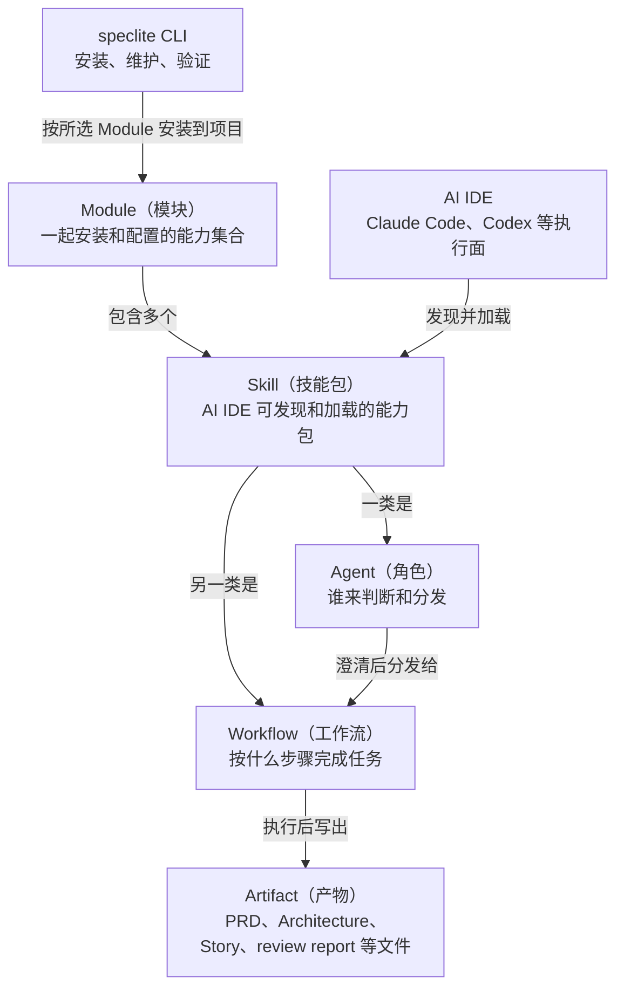
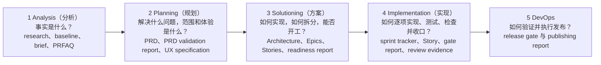
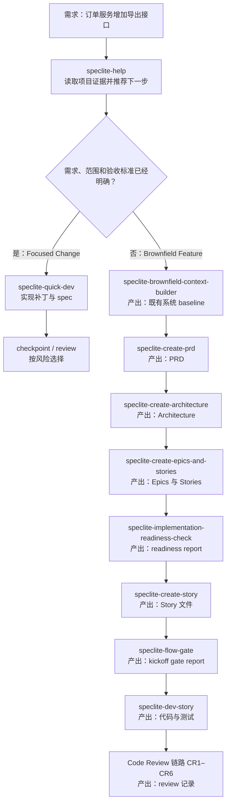
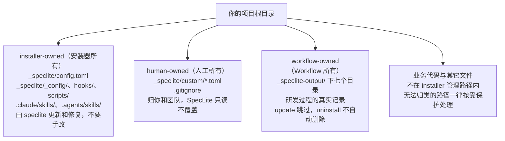

# SpecLite Concepts Primer（SpecLite 概念体系科普分享稿）

本稿是一份面向使用者的分享讲稿，用 17 页讲清 SpecLite 的概念体系，约 25 分钟。它是 Supplementary Public Material（公开补充材料），不是规范来源；每页的事实都回链到 `docs/` 中的主要公开文档，发生冲突时以那些文档为准。

## How to Use This Script（如何使用本稿）

听众是研发工程师、架构师、技术负责人和项目交付负责人，多数没有用过 SpecLite。本稿只从使用者角度讲，不涉及 CLI 内部实现和 SpecLite 自身的维护流程。

每一页由四部分组成：

- 标题：页面主题。
- 投影：放到屏幕上的内容，一句主张加一张图或不超过三条要点。
- 讲者备注：口语化讲稿，可以照着讲。
- 出处：支撑这一页的 `docs/` 文档。

听完后，听众应能回答六个问题。下表给出每个问题对应的页码和建议用时：

| 听众要能回答的问题 | 页码 | 建议用时 |
|---|---|---|
| SpecLite 解决什么问题，不是什么？ | 1–3 | 4 分钟 |
| Agent、Skill、Workflow、Module 各是什么，是什么关系？ | 3–8 | 7 分钟 |
| SDLC 五个阶段各解决什么、产出什么？ | 9–10 | 3 分钟 |
| 一个需求从想法到交付怎么走，使用者每步做什么？ | 11–14 | 6 分钟 |
| 安装后项目里多了什么，哪些归 SpecLite 管，哪些归自己管？ | 15 | 2 分钟 |
| 上手第一步做什么？ | 16–17 | 3 分钟 |

贯穿例子：**给一个已有的订单服务加“按条件导出 CSV”的接口**，团队刚接手这个服务，对现状不熟。这是为讲解虚构的通用场景，不对应任何真实客户或项目。

## Part 1: The Problem（要解决的问题）

### Page 1: The Problem（要解决的问题）

**投影：** AI Coding 进入真实项目后，缺的不是更好的提示词，而是三件事。

- 能力怎么装进项目，并让 AI IDE 找得到。
- 工作怎么按可重复的流程组织，而不是每次从头聊。
- 配置、安装内容和研发产物各归谁管、活多久。

**讲者备注：**

先不讲任何概念，讲问题。大家用 AI 写代码，一个人玩得很顺，一到团队交付就开始出状况：同一件事，每个人的提示词不一样；这次聊出来的方案，下次会话就没了；AI 生成的需求文档、设计文档散落在各处，谁也说不清哪份算数。

SpecLite 的文档把它要解决的问题归纳成三条。第一，哪些方法论能力要装进项目，并且让 AI IDE 能发现它们。第二，用可重复的 Workflow（工作流）来组织分析、规划、方案、实现、评审和发布。第三，让配置、安装内容和工作流产物各自有清晰的事实来源和生命周期。

一句话定位：SpecLite 是一个 local-first CLI control plane，直译是“本地优先的命令行控制面”。它把一套可审查的 AI Coding 方法论安装到你的项目目录里，并负责维护、验证和解释安装状态。后面所有概念，都是围绕这三个问题展开的。

**出处：** [`speclite-orientation.md`](../../tutorials/speclite-orientation.md) 的 What SpecLite Is（SpecLite 是什么）。

### Page 2: What SpecLite Is Not（它不是什么）

**投影：** 先划清边界，可以省掉一半误解。

- 不替代：不替代 AI IDE，也不替代团队的判断。
- 不托管、不装依赖：没有远端服务，也不安装框架或语言运行时。
- 不强制：不要求每个任务走完整条流水线。

**讲者备注：**

文档列了五条“不是”，我按使用者最容易踩的顺序讲。

第一，它不是远端托管服务。控制中心、Skill 镜像和工作流产物都在你的本地项目里，没有一个后台在托管你的研发流程或项目数据。

第二，它不是 Claude Code、Codex 这类 AI IDE 的替代品。命令行工具只管本地运行状态，真正执行角色和工作流的是 AI IDE。

第三，它不是项目依赖安装器。安装时你可以选 React、Java、npm package 这样的生态模块，但选了只是多装对应的 SpecLite 能力包，不会帮你装框架或语言运行时。

第四，它不是固定流水线。既有项目、小修复、完整的产品规划，可以走不同的入口，这一点第 10 页会展开。

第五，它不是自动保证质量的黑盒。它提供流程、门禁和证据，但需求对不对、设计行不行、代码能不能发，还是团队自己判断。

**出处：** [`speclite-orientation.md`](../../tutorials/speclite-orientation.md) 的 What SpecLite Is Not（SpecLite 不是什么）。

### Page 3: Big Picture（全景图）

**投影：** 命令行把方法论装进项目，AI IDE 执行已安装的 Skill，Workflow 把结果写成可审查的 Artifact。



**讲者备注：**

这张图是今天的地图，后面五页就是把图上的方框一个一个讲清楚。

先看分工。左上角是 `speclite` 命令行，它只做三件事：安装、维护、验证。它不会替你写 PRD，也不会替你做代码评审。真正干活的是 AI IDE，它加载装到项目里的 Skill。

再看层级，这是最容易混的地方。Module、Skill、Agent、Workflow、Artifact 不是同一层的同义词。Module 是安装时的组织边界；Skill 是 AI IDE 加载的包；Agent 和 Workflow 是两类职责不同的 Skill；Artifact 是 Workflow 执行完留下的文件。

记一句话就够：命令行把方法论安装并维护在项目中，AI IDE 执行已安装的 Skill，Workflow 把结果写成可审查的 Artifact。

**出处：** [`speclite-orientation.md`](../../tutorials/speclite-orientation.md) 的 Big Picture（全景图）与 Core Concepts（核心概念）；[`skill-taxonomy-and-sdlc.md`](../../explanation/skill-taxonomy-and-sdlc.md) 的 Mental Model（心智模型）。

## Part 2: Core Concepts（核心概念）

### Page 4: Module（模块）

**投影：** Module 回答“哪些能力一起装”。

- `core`：必选，提供共享的帮助、协作、文档和评审能力。
- `sdlc`：默认选中，提供五个研发阶段的 Agent 和 Workflow。
- ecosystem modules：可选，只在你显式选择后才进入项目。

**讲者备注：**

Module，中文叫模块，大白话就是“一起安装、一起配置的一组能力”。你只在安装那一刻感知到它：装哪些。

官方模块分三种。`core` 是必选的基础，帮助、头脑风暴、文档、评审辅助这些跨阶段的共享能力都在这里。`sdlc` 默认选中，它依赖 `core`，提供软件开发生命周期各阶段的角色和工作流，今天讲的大部分内容都在这个模块里。

第三种是 ecosystem module，生态模块，面向具体技术栈或项目形态。目前有八个：前端的 React 和 Vue，后端的 Java Spring Boot、Node.js 和 Python，以及 npm package、CLI tool、documentation-only 三种项目形态。它们依赖 `sdlc`，默认不装，要在交互式安装里显式选择。

使用场景：我们的订单服务如果是 Java Spring Boot 写的，安装时可以多选一个 `ecosystem-backend-java-springboot`，得到针对这个技术栈的分析能力。再强调一次第 2 页的边界：选了它不会帮你装 Java 或 Spring Boot，只是多装了对应的 SpecLite 能力包。

**出处：** [`speclite-modules.md`](../../explanation/speclite-modules.md)；[`ecosystem-skills.md`](../../reference/skills/ecosystem-skills.md)；[`speclite-orientation.md`](../../tutorials/speclite-orientation.md) 的 Default Modules（默认 Module）。

### Page 5: Skill（技能包）

**投影：** Skill 是 AI IDE 能发现和加载的能力包，是所有能力的统一包装。

- 每个 Skill 是一个带 `SKILL.md` 的目录，安装在 `.claude/skills/` 或 `.agents/skills/`。
- Agent 和 Workflow 都是 Skill，只是职责不同。
- 装了什么以项目里的实际安装为准，不以“听说有”为准。

**讲者备注：**

Skill，中文可以叫技能包，大白话是“AI IDE 能认出来并加载的一个能力包”。形态很朴素：一个目录，里面有一份 `SKILL.md` 入口说明。默认安装会给两类 AI IDE 各放一份：Claude Code 看 `.claude/skills/`，Codex 这类支持 `.agents/skills` 的工具看 `.agents/skills/`。

数量上给大家一个感觉。按文档的当前快照，`core` 有 19 个 Skill 包，`sdlc` 有 50 个，其中 7 个是 Agent。

关键是这一句：Skill 是包装和加载单位，不等于 Workflow。Agent 是一类 Skill，Workflow 是另一类 Skill。所以别人说“调用一个 Skill”，你要再问一句：这是个角色，还是个流程。

使用场景：在 AI IDE 里说“请使用 `speclite-create-prd`”，IDE 就会加载这个 Skill 并按它的流程执行。这是对话里的操作，不是在终端里敲命令。

还有一个提醒：SpecLite 能提供某个 Skill，不代表你的项目已经装了它。没选的生态模块不会进入你的项目，装了什么要看项目里的实际安装状态。

**出处：** [`use-installed-skills.md`](../../how-to/use-installed-skills.md) 的 Discovery Model（发现模型）；[`core-skills.md`](../../reference/skills/core-skills.md)；[`sdlc-workflows.md`](../../reference/skills/sdlc-workflows.md) 的 Snapshot（当前快照）；[`skill-taxonomy-and-sdlc.md`](../../explanation/skill-taxonomy-and-sdlc.md)。

### Page 6: Agent（角色）

**投影：** Agent 回答“谁来判断和分发”。

- 7 个角色：Alice（Business Analyst）、Taylor（Technical Writer）、Sarah（Open Source Docs Steward）、Paul（Product Manager）、Uma（UX Designer）、Adam（System Architect）、David（Senior Software Engineer）。
- 激活后保持同一角色口径，直到你让它退出。
- Agent 不替代 Workflow：它澄清和分发，流程由 Workflow 执行。

**讲者备注：**

Agent，这里指角色。大白话：一个带着固定身份和菜单的协作者，帮你先把问题想清楚，再把明确的任务交给对应的流程。

目前 `sdlc` 模块里有 7 个角色。分析师 Alice，技术写作 Taylor，文档治理 Sarah，产品经理 Paul，体验设计 Uma，架构师 Adam，开发工程师 David。注意，目前没有独立的 DevOps 角色。

它和普通提示词的区别在于“持续”。你激活 Paul，后面多轮对话他都保持产品经理的判断框架，直到你让他退出。它和 Workflow 的区别在于职责：Agent 负责谁来判断和分发，Workflow 负责按什么步骤完成。Agent 不应该把流程步骤再抄一遍。

使用场景：业务方只说了一句“订单要能导出”，导给谁、导哪些字段、数据量多大都没说。这时激活 Paul，让他以产品经理的角度追问清楚，再由他分发到创建 PRD 的 Workflow。

反过来，如果你已经明确要“创建 Architecture”，直接调用对应的 Workflow 就行，不用先叫一个角色出来。

**出处：** [`agent-roster.md`](../../reference/skills/agent-roster.md)；[`speclite-agents.md`](../../explanation/speclite-agents.md)。

### Page 7: Workflow and Artifact（工作流与产物）

**投影：** Workflow 回答“按什么步骤完成”；Artifact 是它留在项目里的文件。

- 一个 Workflow 讲清六件事：何时用、要什么输入、按什么步骤、产物写到哪、哪些不能猜、怎样算完成。
- 细节按需加载，不靠一次性大提示词。
- 产物是文件，不是聊天记录：PRD、Architecture、Story、review report。

**讲者备注：**

Workflow，工作流，大白话是“一份写好的做事规程”。它把一个复杂任务拆成可执行的步骤、检查清单、模板和产物约定。

一个可执行的 Workflow 会说明六件事。Trigger，什么时候该用它。Inputs，需要哪些文档、代码、配置或者你的授权。Steps，按什么顺序做。Outputs，产物写到哪里，谁接着用。Boundaries，哪些事实不能猜，哪些写入必须先问你。Verification，怎么证明做完了。

文档里有个词叫渐进式披露，意思是入口只给足够启动的信息，细节到了那一步才加载。好处是 AI 每次只专注当前这一步，步骤和产物也能被单独检查。

Artifact，产物，就是 Workflow 执行后写下或维护的文件。它的价值在于可审查：换一个会话、换一个人，文件还在。

使用场景：调用 `speclite-create-prd`，它会按步骤和你确认需求，最后在规划产物目录下写出 PRD 文件。评审的时候，大家看的是这份文件，不是谁的聊天截图。

也别滥用。只是想问一个实现细节，直接读代码和文档就好，不用为了回答一个问题启动一个 Workflow。

**出处：** [`speclite-workflows.md`](../../explanation/speclite-workflows.md)；[`skill-taxonomy-and-sdlc.md`](../../explanation/skill-taxonomy-and-sdlc.md) 的 Workflow Boundary（Workflow 边界）。

### Page 8: Choosing an Entry（入口怎么选）

**投影：** 状态问题交给 CLI，方向问题先用 Help，角色问题交给 Agent，明确任务交给 Workflow。

| 你现在的问题 | 入口 |
|---|---|
| “装好了吗？” | `speclite status`，必要时 `speclite validate` |
| “下一步该用什么？” | `speclite-help` |
| “想让某个角色先帮我判断。” | 对应的 Agent |
| “目标、输入和产物都明确了。” | 直接调用对应的 Workflow |

**讲者备注：**

概念讲完，落到一个实际问题：我现在该用哪个？文档给了一句口诀，就是屏幕上这句。

状态问题，比如装没装好、要不要更新，属于命令行，在终端里运行 `speclite status` 或 `speclite validate`。

方向问题，不知道下一步干什么，用 `speclite-help`。它是一个 Skill，会读取项目里已安装的能力目录、配置和已有产物，给出有依据的建议，不会凭空补全项目事实。

角色问题，问题还模糊，需要有人持续追问，激活对应的 Agent。

明确任务，目标、输入、期望产物都清楚了，直接调用 Workflow，不必多绕一层角色。

文档里的口诀还有第五句：维护 SpecLite 自身方法论内容的工具叫 support Skill，它不属于默认安装，普通项目开发者用不到，今天不展开。

还有一种情况不需要启动任何东西：只是想查一个命令、一个目录或一份能力清单，直接看参考文档。

**出处：** [`skill-taxonomy-and-sdlc.md`](../../explanation/skill-taxonomy-and-sdlc.md) 的 Entry Decision Table（入口决策表）；[`speclite-orientation.md`](../../tutorials/speclite-orientation.md) 的 Choose Your Entry（选择使用入口）。

## Part 3: SDLC Phases（SDLC 阶段）

### Page 9: SDLC Five Phases（SDLC 五阶段）

**投影：** 五个阶段，各回答一个问题，各有自己的典型产物。



**讲者备注：**

SDLC 是软件开发生命周期。`sdlc` 模块把角色和工作流按五个阶段组织，每个阶段回答一个问题。

第一阶段 Analysis，分析，回答“当前系统、用户、市场或领域的事实是什么”。典型产物是调研报告、既有系统的基线、产品简报。

第二阶段 Planning，规划，回答“要解决什么问题，范围和用户体验是什么”。典型产物是 PRD，也就是产品需求文档，以及 PRD 校验报告和 UX 规格。

第三阶段 Solutioning，方案，回答“如何实现，工作如何拆分，是否具备实现条件”。典型产物是架构文档、Epic 和 Story、评审记录和 readiness report，也就是“能不能开工”的检查报告。Epic 是一组相关的工作，Story 是其中可以单独交付的一项。

第四阶段 Implementation，实现，回答“如何逐项实现、测试、检查并安全收口”。典型产物是迭代跟踪表、Story 文件、门禁报告、代码和评审证据、复盘记录。

第五阶段 DevOps，回答“如何验证并执行发布”。这里要如实讲现状：目前落地的只有 npm 包发布这一个 Workflow，CI/CD 和部署相关目录是保留位，第 14 页会再说。

**出处：** [`sdlc-phases.md`](../../reference/sdlc-phases.md)，这是五阶段的唯一源定义。

### Page 10: Not a Fixed Pipeline（不是固定流水线）

**投影：** 阶段用来定位和交接，不是必须走完的流水线。文档给了三条常见路径。

- Brownfield Feature（既有项目功能）：缺少可信的项目上下文，且变更影响多个模块。
- Focused Change（明确的小型变更）：需求、范围和验收标准已经明确。
- Role-Led Discovery（角色主导的发现）：知道需要哪类专业判断，但选不出具体流程。

**讲者备注：**

看完五阶段，大家最常见的反应是：改个小东西也要走五步吗？不用。文档的原话是，阶段是发现、排序和交接模型，不要求每个任务机械地走完整链路。

文档给了三条常见路径。

第一条，既有项目功能。先恢复既有系统的基线，再写 PRD、做架构、拆 Epic 和 Story、做开工检查，然后进入 Story、门禁、实现和代码评审。适合对系统缺少可信了解、变更又会影响多个模块的情况。brownfield 指的就是既有系统。

第二条，明确的小型变更。可以先问一下 `speclite-help`，然后直接用 Quick Dev，再按风险选择检查点或评审。需求、范围和验收标准已经清楚时，不用为了形式完整去生成所有规划产物。

第三条，角色主导的发现。先激活一个 Agent，把事实和目标澄清，再分发到具体的 Workflow，最后检查产物。

怎么选，文档的规则很直接：根据真实任务选择起点；拿不准就让 `speclite-help` 读项目里的证据，不要凭记忆选。

**出处：** [`skill-taxonomy-and-sdlc.md`](../../explanation/skill-taxonomy-and-sdlc.md) 的 Common Routes（常见路径）与 Selection Rules（选择规则）；[`sdlc-phases.md`](../../reference/sdlc-phases.md) 的 Identifier Rules（标识规则）。

## Part 4: One Requirement End to End（一个需求的完整流转）

### Page 11: One Requirement End to End（一个需求的完整流转）

**投影：** 例子：给已有的订单服务加一个“按条件导出 CSV”的接口。先选路，再走路。



**讲者备注：**

现在用一个例子把前面的概念串起来。场景是通用的：团队刚接手一个订单服务，业务方要一个按条件导出 CSV 的接口。

第一步不是写代码，而是选路。图上这个菱形就是使用者的第一个判断，也就是上一页的三条路径。

如果你对这个服务很熟，导出哪些字段、谁能导、怎么验收都清楚，走左边：Quick Dev，再按风险做检查。

我们的设定是刚接手、对现状不熟，而且导出会碰到查询、权限、大数据量这些地方，影响不止一个模块。这符合文档对“既有项目功能”路径的描述，所以走右边这条长的。接下来三页，每页讲一段：调用什么，产出什么文件，你要做什么判断。

提前说明一点：这条链路是文档给出的概括顺序。具体到你的项目，每一步之后都可以回到 `speclite-help`，让它基于当前产物告诉你下一步。

**出处：** [`skill-taxonomy-and-sdlc.md`](../../explanation/skill-taxonomy-and-sdlc.md) 的 Common Routes（常见路径）；[`sdlc-workflows.md`](../../reference/skills/sdlc-workflows.md)。

### Page 12: Walkthrough: Analysis to Planning（从现状到 PRD）

**投影：** 先恢复事实，再定义需求。你要判断的是：证据够不够，范围对不对。

| 调用 | 产出 | 你的判断 |
|---|---|---|
| `speclite-help` | 状态说明与下一步建议，不写产物 | 建议是否基于项目证据？ |
| `speclite-brownfield-context-builder` | 既有系统的 evidence、baseline 与 planning handoff | 基线与你了解的事实是否一致？ |
| `speclite-create-prd` | `prd/prd.md` | 范围、非目标和验收是否写清？ |

**讲者备注：**

第一步，在 AI IDE 里打开项目，说：请使用 `speclite-help`，我刚接手这个订单服务，要加一个导出接口，下一步该用什么。它会读取已安装的能力目录、配置和已有产物，告诉你已确认的事实、缺失的证据和推荐的下一步。它主要是读取和路由，拿到建议不等于某个流程已经执行。你要检查的是：它的建议有没有引用项目里的证据，还是在泛泛而谈。

第二步，分析阶段，调用 `speclite-brownfield-context-builder`。它把既有代码库恢复成有证据支撑的基线，默认写到项目知识目录的 `brownfield/` 下，另外可能生成给规划用的交接材料。按教程的做法，这一步只新增分析产物，不改业务代码，遇到事实冲突应停下来由你裁决。你的判断是：这份基线和你知道的情况对得上吗？比如现有的订单查询入口、权限校验的位置。

第三步，规划阶段，调用 `speclite-create-prd`，产物是规划产物目录下的 `prd/prd.md`。你的判断是产品层面的：导出哪些字段、谁有权限、单次最多导多少、什么不在本次范围内。想再稳一点，可以用 `speclite-validate-prd` 生成一份带日期的 PRD 校验报告。

这个需求是个接口，没有界面，所以 UX 设计那一步可以不做。这就是“按真实任务选择”的含义。

**出处：** [`use-installed-skills.md`](../../how-to/use-installed-skills.md)；[`first-brownfield-project.md`](../../tutorials/first-brownfield-project.md)；[`sdlc-workflows.md`](../../reference/skills/sdlc-workflows.md) 的 Analysis（分析阶段）与 Planning（计划阶段）；[`workflow-artifact-layout.md`](../../reference/workflow-artifact-layout.md)。

### Page 13: Walkthrough: Solutioning（从 PRD 到可开工）

**投影：** 方案阶段回答三件事：怎么做，怎么拆，能不能开工。

| 调用 | 产出 | 你的判断 |
|---|---|---|
| `speclite-create-architecture` | `architecture/architecture.md` | 技术取舍是否接受？ |
| `speclite-create-epics-and-stories` | `epics/epics.md` | 拆分粒度是否可独立交付？ |
| `speclite-implementation-readiness-check` | 带日期的 implementation readiness report | 报告指出的缺口是否已处理？ |

**讲者备注：**

有了 PRD，进入方案阶段，三步。

第一步，`speclite-create-architecture`，产物是方案产物目录下的 `architecture/architecture.md`。对我们的导出接口，这里要定的是：同步导出还是异步导出，大数据量怎么处理，复用现有的查询和权限逻辑还是新写。这些取舍需要你确认；按文档的说明，这个流程只有在你选择继续之后才会往下写。拿不准的时候，可以先激活架构师 Adam 聊清楚再执行。

第二步，`speclite-create-epics-and-stories`，它从 PRD 和 Architecture 拆出 Epic 和 Story，产物是 `epics/epics.md`。你的判断是粒度：每个 Story 能不能单独交付、单独验收。比如“导出接口的查询与权限”“大数据量处理”“导出审计日志”。

第三步，`speclite-implementation-readiness-check`，检查 PRD、UX、Architecture、Epics 和 Stories 是否可以进入实现，产物是一份带日期的报告。这一步的意义是把“我觉得可以开工了”变成一份可以审查的文件。

这个阶段还有 Story Review 这组设计审查流程，由 reviewer、evaluator、fixer 三个 Workflow 组成，分别负责提出问题、评估问题、按结论修订 Story。用不用、什么时候用，可以让 `speclite-help` 结合当前产物给建议。

**出处：** [`sdlc-workflows.md`](../../reference/skills/sdlc-workflows.md) 的 Solutioning（方案阶段）；[`workflow-artifact-layout.md`](../../reference/workflow-artifact-layout.md) 的 Root and Planning Artifacts（根目录与规划产物）。

### Page 14: Walkthrough: Implementation（从 Story 到收口）

**投影：** 一个 Story 一个闭环：准备 Story，过门禁，实现，评审收口。

| 调用 | 产出 | 你的判断 |
|---|---|---|
| `speclite-create-story` | `stories/{story-key}.md` | Story 上下文是否足够实现？ |
| `speclite-flow-gate` | `flow-gates/{story-key}-story-kickoff-gate.md` | 开发前置条件是否通过？ |
| `speclite-dev-story` 与 Code Review `CR1`–`CR6` | 代码、测试与 `code-reviews/` 下的记录 | 发现的问题是否都有结论？ |

**讲者备注：**

进入实现阶段。文档给的链路是 Sprint Planning、Story、Dev Story 和 Code Review。

`speclite-sprint-planning` 创建迭代跟踪文件 `sprint-status.yaml`，后面多个流程都会更新它。

然后是单个 Story 的闭环。`speclite-create-story` 为这一项工作生成上下文完整的 Story 文件，这是开发的执行依据。

接着是 Flow Gate，流程门禁。story kickoff gate 是在 `speclite-dev-story` 把 Story 推进到进行中之前执行的门禁，它验证的是开发前置条件，不是“已经做完”。安装到项目里的 `flow-gate-enforcement` Hook 会在直接触发 `speclite-dev-story` 之前检查这份报告；检查不通过就拦下来，它不会替你生成报告。

门禁通过后，`speclite-dev-story` 执行实现、测试和交付。之后是代码评审链路，六个 Workflow 各管一件事：审查、评估发现的问题、修复、提炼规则、跟踪待办、收尾并同步状态。把“提出问题”“判断问题是否成立”“修复”分开，是为了避免自己审自己。记录都落在 `code-reviews/` 下以 Story 编号命名的目录里。一个 Epic 做完，可以用 `speclite-retrospective` 做复盘。

最后说发布。DevOps 阶段目前落地的只有 `speclite-npm-publisher`，用于发布 npm 包，对我们这个服务接口不适用。CI/CD 能力在 README 的 Roadmap 里还是未完成项，属于规划中，今天不把它当成现有能力来讲。所以这个例子在 SpecLite 里的终点是评审收口，部署沿用团队现有的方式。

**出处：** [`sdlc-workflows.md`](../../reference/skills/sdlc-workflows.md) 的 Implementation（实现阶段）与 DevOps（DevOps 阶段）；[`flow-gate-handoff.md`](../../reference/glossary/flow-gate-handoff.md)；[`flow-gate-handoff-pitfalls.md`](../../explanation/flow-gate-handoff-pitfalls.md)；[`workflow-artifact-layout.md`](../../reference/workflow-artifact-layout.md)；[`README.md`](../../../README.md) 的 Roadmap（后续迭代路线）。

## Part 5: After Install（安装之后）

### Page 15: What Lands in Your Project（安装后多了什么）

**投影：** 项目里多出三类东西，按“谁负责”来分，而不是按目录名来分。



**讲者备注：**

装完以后项目里多了什么？很多人第一反应是看目录名。更有用的是看谁负责，文档叫文件所有权。

第一类，installer-owned，安装器所有。包括 `_speclite/` 下的配置、索引、Hook 和脚本，以及两个 Skill 镜像目录。它们由 `speclite` 命令更新和修复。记住一条：不要手改。想调整某个 Skill 的行为，走定制文件，不要直接改镜像目录，手改会被校验报告为漂移。另外，“安装器所有”也不等于它可以随便覆盖，写入前仍要通过比对检查，并且需要你用 `--yes` 明确授权。

第二类，human-owned，人工所有。`_speclite/custom/` 下的定制文件和 `.gitignore`。SpecLite 会读它们，但不会重写。这是你和团队的地盘。

第三类，workflow-owned，Workflow 所有。就是 `_speclite-output/`，里面按阶段分了七个目录：头脑风暴、分析、规划、方案、实现、DevOps 各一个，再加一个项目知识库。前面例子里的 PRD、Architecture、Story、评审记录都在这里。它不是缓存，是研发历史：更新时会跳过，修复时不会重建，卸载时也不会自动删除。

还有不属于这三类的路径，比如你的业务代码。分类规则是，无法归类的路径一律按受保护处理，不会被当成安装器可写的目标。

提交方面：`_speclite/`、Skill 镜像、Hook 配置和 `_speclite-output/` 都提交给团队共享；个人级配置和临时状态不提交。安装器只往 `.gitignore` 写两条个人配置规则，其余的忽略规则要按安装文档手动追加。

**出处：** [`file-ownership-model.md`](../../explanation/file-ownership-model.md)；[`runtime-layout.md`](../../reference/runtime-layout.md) 的 Commit Guidance 列与 Version Control Guidance（版本控制指引）；[`workflow-artifact-layout.md`](../../reference/workflow-artifact-layout.md) 的 Configuration Mapping（配置映射）；[`install-speclite.md`](../../how-to/install-speclite.md)。

## Part 6: Getting Started（上手）

### Page 16: Getting Started（怎么开始）

**投影：** 三步上手：装命令行，装到项目，问 `speclite-help`。

```sh
npm install -g @fancyliu/speclite
speclite install /path/to/project
speclite install /path/to/project --yes
```

**讲者备注：**

上手只有三步。

第一步，装命令行。前提是本机有 Node.js 22 或以上，推荐 24 LTS。运行 `npm install -g @fancyliu/speclite`，然后 `speclite --version` 确认可用。

第二步，装到项目。这里有个设计值得注意：`speclite install` 后面跟项目路径，不带 `--yes`，只是安全预览，不写任何文件。确认目标目录没问题后，加上 `--yes` 才是授权写入。默认会装 `core` 和 `sdlc` 两个模块，同时为 Claude Code 和支持 `.agents/skills` 的工具各生成一份 Skill 镜像。要选生态模块，或者想调整配置，再加 `--interactive`。装完运行 `speclite status` 和 `speclite validate`，这两个命令都是只读的。

第三步，在项目根目录打开 AI IDE，第一个建议尝试的 Skill 是 `speclite-help`。可以这样说：请使用 `speclite-help`，基于当前项目已安装的配置、能力目录和已有产物，判断状态并推荐一个明确的下一步。

有一个常见的坑：AI 会话里必须能直接执行 `speclite` 这个命令。先在同一个会话里运行 `command -v speclite` 确认。用 `npx` 临时运行可以完成安装，但不会让后续的 AI 会话获得这个命令。

如果你想先练手，不要直接拿生产仓库，教程建议用一个专门的小型既有仓库走一遍既有项目分析。

**出处：** [`quick-start.md`](../../quick-start.md)；[`use-installed-skills.md`](../../how-to/use-installed-skills.md)；[`first-brownfield-project.md`](../../tutorials/first-brownfield-project.md)。

### Page 17: Common Misreadings（常见误解）

**投影：** 最常见的三组误解。

- 关于安装：选了生态模块不等于装了框架；`speclite-help` 是对话里的 Skill，不是终端命令。
- 关于目录：Skill 镜像不能手改；`_speclite-output/` 不是缓存。
- 关于流程：五阶段不必走完；有了门禁和评审，也不等于质量自动达标。

**讲者备注：**

最后集中澄清几个误解，都是文档里明确写过的。

关于安装。选了 React 或 Java 的生态模块，只是多装了 SpecLite 的能力包，不会安装框架。SpecLite 提供某个生态模块，也不等于你的项目里已经装了它。还有，`speclite-help`、`speclite-create-prd` 这些是在 AI IDE 对话里调用的 Skill，不是终端里的子命令，目前也没有用命令行直接运行某个 Skill 的入口。

关于目录。`.claude/skills/` 和 `.agents/skills/` 是可验证、可修复的安装镜像，不是可以各自演进的来源，不要手改。`_speclite-output/` 不是安装缓存，它保存的是研发历史，默认应该长期保留。“安装器所有”不表示静默覆盖，“人工所有”也不表示 SpecLite 完全不读。

关于流程。五个阶段不是必须走完的流水线。Agent 不替代 Workflow。story kickoff gate 验证的是开发前置条件，不是 Story 已经完成。最后回到第 2 页：SpecLite 提供流程、门禁和证据，判断还是团队来做。

顺带说明哪些还在规划中。按 README 的 Roadmap，既有项目多次迭代的产物目录体系、微服务跨多仓库的迭代方式、测试架构模块（TEA）、CI/CD 能力、企业级定制代码规范，目前都是未完成项。做选型和排期时，请把它们当作规划，而不是现有能力。

今天的内容可以浓缩成一句话：命令行负责装和管，AI IDE 负责执行，Workflow 把过程变成留在项目里的文件。回去以后的第一步，是在一个练手仓库里装上它，然后问一问 `speclite-help`。

**出处：** [`runtime-boundaries.md`](../../explanation/runtime-boundaries.md) 的 Common Misreadings（常见误解）；[`file-ownership-model.md`](../../explanation/file-ownership-model.md) 的 Common Misreadings（常见误解）；[`flow-gate-handoff-pitfalls.md`](../../explanation/flow-gate-handoff-pitfalls.md)；[`first-brownfield-project.md`](../../tutorials/first-brownfield-project.md) 的 Lab Boundary（实验边界）；[`README.md`](../../../README.md) 的 Roadmap（后续迭代路线）。

## Glossary Quick Reference（术语速查表）

下表供分享后查阅，定义均取自 `docs/` 文档；完整术语表见 [`glossary/index.md`](../../reference/glossary/index.md)。

| 术语 | 大白话 | 出处 |
|---|---|---|
| local-first CLI control plane | 本地优先的命令行控制面：安装、维护和验证都发生在本地项目里。 | [`speclite-orientation.md`](../../tutorials/speclite-orientation.md) |
| Module（模块） | 一起安装、配置和索引的一组能力：`core`、`sdlc` 和可选的 ecosystem modules。 | [`speclite-modules.md`](../../explanation/speclite-modules.md) |
| Skill（技能包） | AI IDE 可以发现和加载的自包含能力包，入口是 `SKILL.md`。 | [`speclite-orientation.md`](../../tutorials/speclite-orientation.md) |
| Agent（角色） | 一类 Skill，激活后以持续角色帮助判断并分发任务，名称通常是 `speclite-agent-*`。 | [`speclite-agents.md`](../../explanation/speclite-agents.md) |
| Workflow（工作流） | 一类 Skill，按明确的输入、步骤、产物和验证完成一项任务。 | [`speclite-workflows.md`](../../explanation/speclite-workflows.md) |
| Artifact（产物） | Workflow 实际产生或维护的文件，例如 PRD、Architecture、Story、review report。 | [`speclite-orientation.md`](../../tutorials/speclite-orientation.md) |
| `speclite-help` | 读取项目证据并推荐下一步的路由 Skill，是首次使用的入口。 | [`use-installed-skills.md`](../../how-to/use-installed-skills.md) |
| SDLC | 软件开发生命周期，分为 Analysis、Planning、Solutioning、Implementation、DevOps 五个阶段。 | [`sdlc-phases.md`](../../reference/sdlc-phases.md) |
| brownfield | 既有系统。brownfield baseline 是从既有代码库恢复出来的证据化基线。 | [`sdlc-workflows.md`](../../reference/skills/sdlc-workflows.md) |
| Epic / Story | Solutioning 阶段拆出的工作单元；Story 文件是实现时的执行依据。 | [`workflow-artifact-layout.md`](../../reference/workflow-artifact-layout.md) |
| Flow Gate（流程门禁） | 针对 Story 或 Epic 状态流转的检查；story kickoff gate 在 Story 进入开发前执行。 | [`flow-gate-handoff.md`](../../reference/glossary/flow-gate-handoff.md) |
| Hook | 随安装进入项目的确定性防护，例如 `flow-gate-enforcement`。 | [`speclite-modules.md`](../../explanation/speclite-modules.md) |
| Skill mirror（Skill 镜像） | 安装到 `.claude/skills/` 与 `.agents/skills/` 的 Skill 副本，属于 installer-owned。 | [`use-installed-skills.md`](../../how-to/use-installed-skills.md) |
| installer-owned | 由安装器生成和管理的文件，可被更新或修复，但需要检查通过并明确授权。 | [`file-ownership.md`](../../reference/glossary/file-ownership.md) |
| human-owned | 由团队人工维护的配置或定制，SpecLite 只读取不重写。 | [`file-ownership.md`](../../reference/glossary/file-ownership.md) |
| workflow-owned | Workflow 执行后产生的过程产物，默认位于 `_speclite-output/`。 | [`file-ownership.md`](../../reference/glossary/file-ownership.md) |

## Appendix A: Documents Read（实际阅读的文档清单）

以下是撰写本稿时实际阅读的文档。标注“节选”的只读了与本稿相关的章节。

- 入口：[`README.md`](../../../README.md)、[`docs/index.md`](../../index.md)、[`quick-start.md`](../../quick-start.md)
- Tutorial：[`speclite-orientation.md`](../../tutorials/speclite-orientation.md)、[`speclite-developer-training.md`](../../tutorials/speclite-developer-training.md)、[`first-brownfield-project.md`](../../tutorials/first-brownfield-project.md)（节选）
- How-to：[`use-installed-skills.md`](../../how-to/use-installed-skills.md)、[`install-speclite.md`](../../how-to/install-speclite.md)（节选）
- Explanation（概念）：[`skill-taxonomy-and-sdlc.md`](../../explanation/skill-taxonomy-and-sdlc.md)、[`speclite-agents.md`](../../explanation/speclite-agents.md)、[`speclite-modules.md`](../../explanation/speclite-modules.md)、[`speclite-workflows.md`](../../explanation/speclite-workflows.md)
- Explanation（边界）：[`file-ownership-model.md`](../../explanation/file-ownership-model.md)、[`runtime-boundaries.md`](../../explanation/runtime-boundaries.md)、[`flow-gate-handoff-pitfalls.md`](../../explanation/flow-gate-handoff-pitfalls.md)（节选）
- Reference（阶段与目录）：[`sdlc-phases.md`](../../reference/sdlc-phases.md)、[`workflow-artifact-layout.md`](../../reference/workflow-artifact-layout.md)、[`runtime-layout.md`](../../reference/runtime-layout.md)（节选）
- Reference（Skill catalog）：[`skills/index.md`](../../reference/skills/index.md)、[`agent-roster.md`](../../reference/skills/agent-roster.md)、[`core-skills.md`](../../reference/skills/core-skills.md)、[`sdlc-workflows.md`](../../reference/skills/sdlc-workflows.md)、[`ecosystem-skills.md`](../../reference/skills/ecosystem-skills.md)
- Reference（术语）：[`glossary/index.md`](../../reference/glossary/index.md)、[`file-ownership.md`](../../reference/glossary/file-ownership.md)、[`runtime-boundaries.md`](../../reference/glossary/runtime-boundaries.md)、[`workflow-artifact.md`](../../reference/glossary/workflow-artifact.md)、[`flow-gate-handoff.md`](../../reference/glossary/flow-gate-handoff.md)
- 文档治理：[`docs/README.md`](../../README.md)、[`_STYLE_GUIDE.md`](../../_STYLE_GUIDE.md)、[`presentations/index.md`](../index.md)

没有阅读 CLI 源码、`assets/source/speclite/` 下的方法论源文件和 `module-help.csv`，本稿的事实只来自上面的清单。另外读了 `scripts/docs/check.mjs`，只用于确认本稿需要满足的文档格式规则，不作为内容来源。

## Appendix B: Facts and Synthesis（原文事实与归纳）

本节区分哪些内容是文档原文事实，哪些是为讲解所做的归纳，方便审阅者核对。

文档原文事实（可在出处文档中找到对应表述）：

- 三个要解决的问题、五条“不是”、概念的层级关系和一句话全景。
- Module 的三种类型、默认选择与依赖关系，八个 ecosystem modules 的名称。
- `core` 19 个、`sdlc` 50 个 Skill 包的快照数量，以及 7 个 Agent 的 name 与 title。
- Workflow 的六个要素、渐进式披露的含义。
- 入口选择口诀与入口决策表。
- 五阶段的顺序、回答的问题和典型产物；“阶段不要求走完整链路”。
- 三条常见路径及其适用条件。
- 各 Workflow 的 Skill id、用途和默认输出位置；story kickoff gate 与 `flow-gate-enforcement` Hook 的行为。
- 三类文件所有权、典型路径、更新/修复/卸载时的行为，以及提交边界。
- 安装前提、安装命令、默认模块与 IDE targets、`speclite-help` 的首次调用方式。
- Roadmap 中标为未完成的项目。

本稿的归纳（文档没有这样的原话，属于讲解需要）：

- 第 1 页开场对团队使用 AI Coding 时常见状况的描述。
- 第 2、17 页把多条原文归并成三组的分组方式。
- 第 3 页的概念关系图：节点和关系来自文档，图本身是重新绘制的。
- 贯穿例子“订单服务导出接口”及其细节（字段、权限、数据量、同步或异步、Story 的拆分示例）均为虚构的通用场景。
- 第 12–14 页“你的判断”一列：依据各 Workflow 的用途推导，不是文档列出的检查清单。
- 第 12 页“该需求没有界面，可以不做 UX 设计”：依据“按真实任务选择起点”的规则作出的推断。
- 第 14 页“把提出问题、判断、修复分开是为了避免自己审自己”：对文档中“各自承担不同职责”一句的通俗转述。
- 第 14 页“部署沿用团队现有的方式”：文档只说明 DevOps 阶段当前的能力范围，没有给出这条建议。
- 第 15 页把“业务代码”作为无法归类路径的例子：文档只给出了分类规则，没有举这个例子。
- Skill、Agent 的中文叫法“技能包”“角色”是为听众加的解释，文档中保留英文。

## Appendix C: Open Questions（待确认事项）

撰写过程中发现以下文档之间的出入，本稿没有自行裁决。稿中涉及的地方按 Reference 文档的写法处理，并在此列出两处原文位置。

| # | 出入 | 位置一 | 位置二 |
|---:|---|---|---|
| 1 | PRD 的默认路径是否带阶段序号和 subject 目录。 | [`speclite-orientation.md`](../../tutorials/speclite-orientation.md) Core Concepts 表：`_speclite-output/planning-artifacts/prd.md` | [`workflow-artifact-layout.md`](../../reference/workflow-artifact-layout.md) Default Directory Tree：`2-planning-artifacts/prd/prd.md` |
| 2 | workflow-owned 的典型路径是否带阶段序号。 | [`file-ownership-model.md`](../../explanation/file-ownership-model.md) Workflow-Owned 一节：`_speclite-output/planning-artifacts/*` 等 | [`runtime-layout.md`](../../reference/runtime-layout.md) 路径表：`_speclite-output/2-planning-artifacts/*` 等 |
| 3 | planning artifacts 包含哪些产物。 | [`workflow-artifact.md`](../../reference/glossary/workflow-artifact.md)：含 Product Brief、Architecture、research | [`workflow-artifact-layout.md`](../../reference/workflow-artifact-layout.md) Configuration Mapping：三者分属 analysis 与 solutioning 目录 |
| 4 | Solutioning 阶段的产物是否都落在 `{solutioning_artifacts}`。 | [`sdlc-phases.md`](../../reference/sdlc-phases.md) Phase Table：Artifact Root 为 `{solutioning_artifacts}` | [`sdlc-workflows.md`](../../reference/skills/sdlc-workflows.md) Solutioning 表：Epics 写入 `{planning_artifacts}/epics`，Story Review 写入 `{implementation_artifacts}/story-reviews` |
| 5 | 菜单码 `PM` 与 `EP` 各对应两个 Skill。 | [`core-skills.md`](../../reference/skills/core-skills.md)：`speclite-party-mode` 为 `PM`，`speclite-editorial-review-prose` 为 `EP` | [`sdlc-workflows.md`](../../reference/skills/sdlc-workflows.md)：`speclite-agent-pm` 为 `PM`，`speclite-edit-prd` 为 `EP` |
| 6 | Sarah 的 title。 | [`speclite-developer-training.md`](../../tutorials/speclite-developer-training.md)：Docs Steward | [`agent-roster.md`](../../reference/skills/agent-roster.md)：Open Source Docs Steward |
| 7 | Planning 阶段的中文名。 | [`sdlc-phases.md`](../../reference/sdlc-phases.md)：Planning（规划） | [`sdlc-workflows.md`](../../reference/skills/sdlc-workflows.md)：Planning（计划阶段） |
| 8 | SDLC skills 覆盖的阶段范围。 | [`quick-start.md`](../../quick-start.md) Use Installed Skills：从分析、计划、方案设计到实现和评审 | [`sdlc-phases.md`](../../reference/sdlc-phases.md)：五阶段含 DevOps |

另有两点需要确认，但不属于文档之间的出入：

- 实现阶段内 Sprint Planning、Create Story、Story Review 与 Flow Gate 之间的精确先后顺序，`docs/` 只给出概括链路；逐步的前后置关系记录在 `module-help.csv` 中，本稿没有查阅。第 11、14 页按 `docs/` 的概括顺序讲述。
- 第 5 页的 Skill 数量是文档的当前快照，会随版本变化；正式分享前建议按当时的 [`core-skills.md`](../../reference/skills/core-skills.md) 与 [`sdlc-workflows.md`](../../reference/skills/sdlc-workflows.md) 复核。

## Related Documents（相关文档）

| Relationship | Document |
|---|---|
| 本主题说明 | [`README.md`](README.md) |
| 演示目录 | [`../index.md`](../index.md) |
| 初学者导览 | [`speclite-orientation.md`](../../tutorials/speclite-orientation.md) |
| 成套培训材料 | [`speclite-developer-training.md`](../../tutorials/speclite-developer-training.md) |
| 入口选择与 SDLC 路径 | [`skill-taxonomy-and-sdlc.md`](../../explanation/skill-taxonomy-and-sdlc.md) |
| SDLC 阶段源定义 | [`sdlc-phases.md`](../../reference/sdlc-phases.md) |
| 文件所有权模型 | [`file-ownership-model.md`](../../explanation/file-ownership-model.md) |
| 首次使用 installed Skill | [`use-installed-skills.md`](../../how-to/use-installed-skills.md) |
